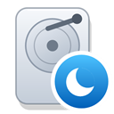
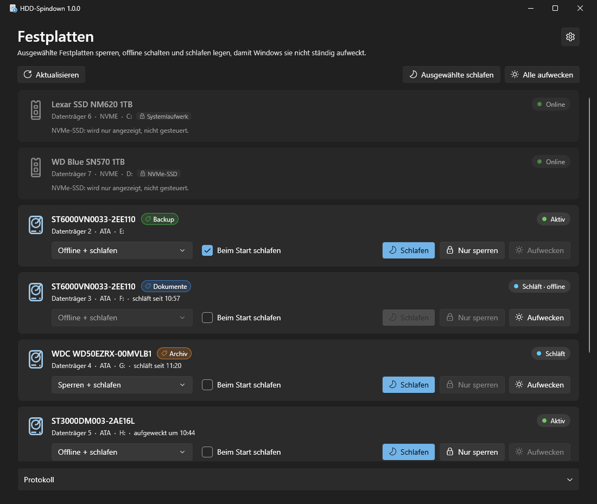
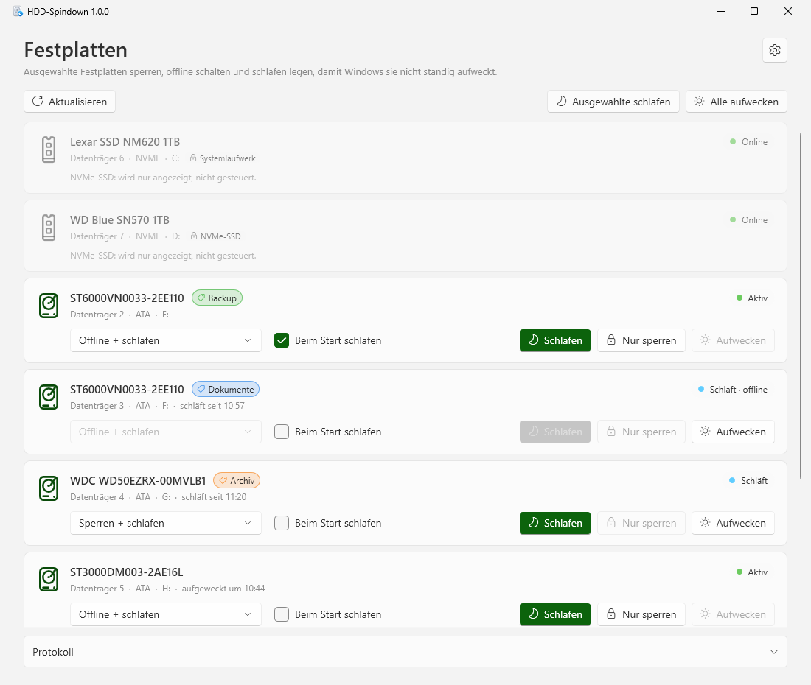
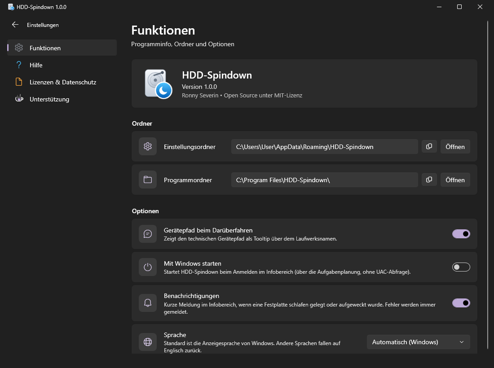
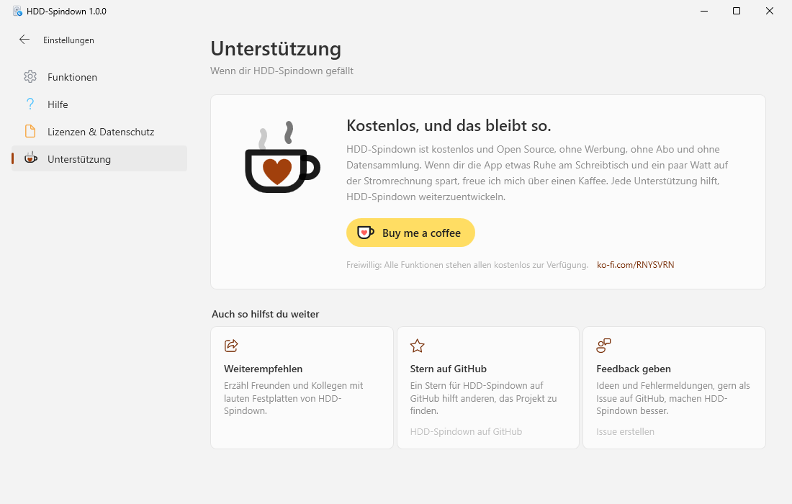

<p align="center">
  
</p>

<h1 align="center">HDD-Spindown</h1>

<p align="center">
  Festplatten unter Windows 11 schlafen legen und schlafen lassen.<br>
  <a href="README.md">English</a> · <b>Deutsch</b>
</p>

<p align="center">
  <a href="https://github.com/RNYSVRN/HDD-Spindown/releases/latest"></a>
  
  <a href="LICENSE"></a>
</p>

<p align="center">
  
  
</p>

Windows weckt Festplatten gern wieder auf, auch wenn gerade niemand sie braucht. **HDD-Spindown** sperrt die Laufwerke einer Platte oder schaltet sie offline und schickt sie erst dann in den Ruhezustand. So bleibt sie wirklich still: leiser, sparsamer, kühler.

## Download

**[⬇ Neuesten Installer herunterladen](https://github.com/RNYSVRN/HDD-Spindown/releases/latest)** (`HDD-Spindown-Setup-x.y.z.exe`)

Keine .NET-Installation nötig, alles ist enthalten. Voraussetzung: Windows 10 (1809) oder Windows 11, 64 Bit.

> [!NOTE]
> **Windows warnt eventuell beim ersten Start.** HDD-Spindown ist kostenlos und deshalb **nicht digital signiert** (eine Signatur kostet laufend Geld).
> - *„Der Computer wurde durch Windows geschützt“* (SmartScreen): auf **Weitere Informationen** → **Trotzdem ausführen** klicken.
> - *„Eine Anwendungssteuerungsrichtlinie hat diese Datei blockiert“* (Smart App Control): Smart App Control lässt nur signierte Programme zu. HDD-Spindown läuft dann nur, wenn Smart App Control ausgeschaltet ist (*Windows-Sicherheit → App- & Browsersteuerung*). Achtung: Einmal ausgeschaltet, lässt es sich nur durch Zurücksetzen von Windows wieder einschalten. Entscheide selbst.
> - Die **Abfrage der Benutzerkontensteuerung** ist normal: Die App braucht Adminrechte, um Datenträger zu steuern.
>
> Der komplette Quellcode liegt in diesem Repository. Du kannst ihn prüfen oder selbst bauen.

## Funktionen

- **Drei Modi je Platte**
  - *Sperren + schlafen*: Die Laufwerke werden gesperrt und ausgehängt, danach schläft die Platte
  - *Offline + schlafen*: zusätzlich offline (am zuverlässigsten, nach einem Neustart wieder online)
  - *Offline + schlafen + deaktivieren*: zusätzlich im Geräte-Manager deaktiviert
- **Zustand live**: aktiv, schläft, gesperrt, offline; „schläft seit …“ bzw. „aufgeweckt um …“, auch wenn Windows die Platte selbst schlafen gelegt hat
- **Zeigt, was eine Platte blockiert**: Ist sie in Benutzung, listet ein Dialog die Programme auf, mit „Erneut versuchen“
- **Beim Start schlafen**, **Mit Windows starten** (über die Aufgabenplanung, ohne UAC-Abfrage) und ein **Tray-Symbol** mit nativem Menü in hell/dunkel
- **Etiketten** mit Farben (z. B. „Filme“, „Backup“)
- **Geschützte Laufwerke**: NVMe-SSDs und das Systemlaufwerk werden nur angezeigt und nie verändert
- **Windows-11-Design (Fluent)**: hell/dunkel, deine Akzentfarbe, passt sich der Fenstergröße an
- **Deutsch und Englisch**, je nach Windows-Anzeigesprache
- **Kommandozeile** für Skripte und Verknüpfungen
- **Privat**: keine Internetverbindung, keine Telemetrie, kein Konto

<p align="center">
  
  
</p>

## Kommandozeile

```
HddSpindown -s J:                 Platte J: schlafen legen (optional: -m OFFLINE | DEACTIVATE | SLEEP)
HddSpindown -l J: -m OFFLINE      nur sperren
HddSpindown -w J:                 aufwecken (ohne Laufwerk: alle)
HddSpindown -t                    nur im Infobereich starten
HddSpindown --lang de|en          Sprache festlegen
```

Das Muster passt auf Laufwerksbuchstabe (`J:`), Namen, Gerätepfad oder Instanz-ID. Läuft die App bereits, wird der Befehl an sie weitergegeben.

## Gut zu wissen

- Lässt sich eine Platte nicht sperren, wird nichts erzwungen (kein Datenverlust). Schließe die angezeigten Programme und klicke auf „Erneut versuchen“.
- `beforeSleep.bat` / `afterSleep.bat` im Programmordner laufen vor dem Schlafenlegen bzw. nach dem Aufwecken (Argumente: Laufwerksbuchstabe, Name, Gerätepfad).
- Einstellungen liegen in `%AppData%\HDD-Spindown\settings.json`. Beim Deinstallieren bleiben sie erhalten; zum vollständigen Entfernen den Ordner löschen.
- Häufiges Anlaufen belastet die Mechanik, lege Platten also besser nicht im Minutentakt schlafen.

## Selbst bauen

Voraussetzungen: [.NET 10 SDK](https://dotnet.microsoft.com/download), optional [Inno Setup 6](https://jrsoftware.org/isdl.php) für den Installer.

```powershell
dotnet build src/HddSpindown -c Release              # App
powershell -ExecutionPolicy Bypass -File installer\build.ps1   # eigenständiges Paket + Installer in dist\
```

## Unterstützung

HDD-Spindown ist kostenlos, und das bleibt so. Wenn dir die App etwas Ruhe und ein paar Watt spart, freue ich mich über einen Kaffee:

<a href="https://ko-fi.com/RNYSVRN"></a>

Ideen und Fehlermeldungen gern als [Issue](https://github.com/RNYSVRN/HDD-Spindown/issues).

## Danksagung

Die Idee stammt von [revoSleep](https://www.meinfach.net/revosleep/), einem Freeware-Tool, das seit Jahren Festplatten schlafen legt. HDD-Spindown ist eine eigenständige Neuentwicklung von Grund auf und enthält keinen Code aus revoSleep. Damit der Umstieg leichtfällt, folgt es denselben Konventionen bei den Kommandozeilen-Schaltern und den Skripten `beforeSleep.bat` / `afterSleep.bat`.

## Lizenz

[MIT](LICENSE) © 2026 Ronny Severin.
