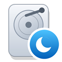
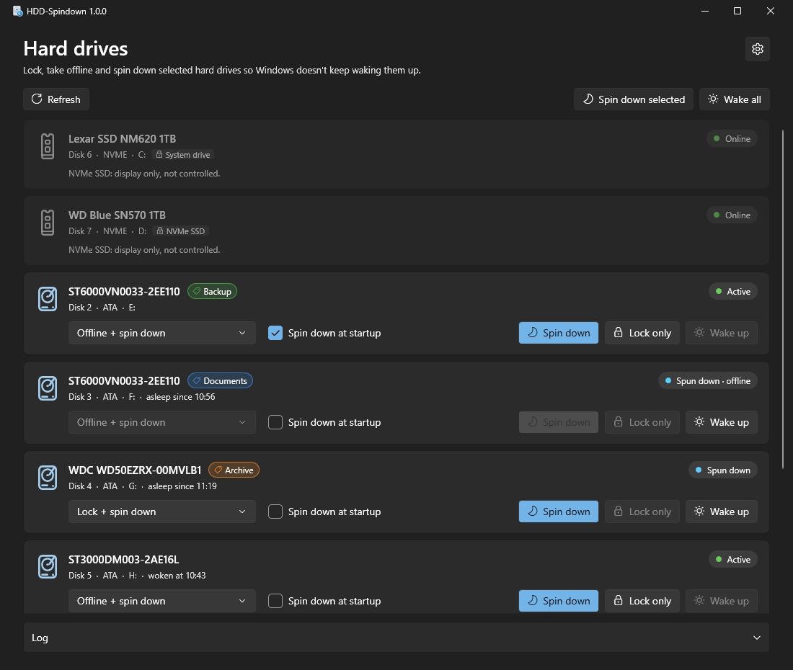
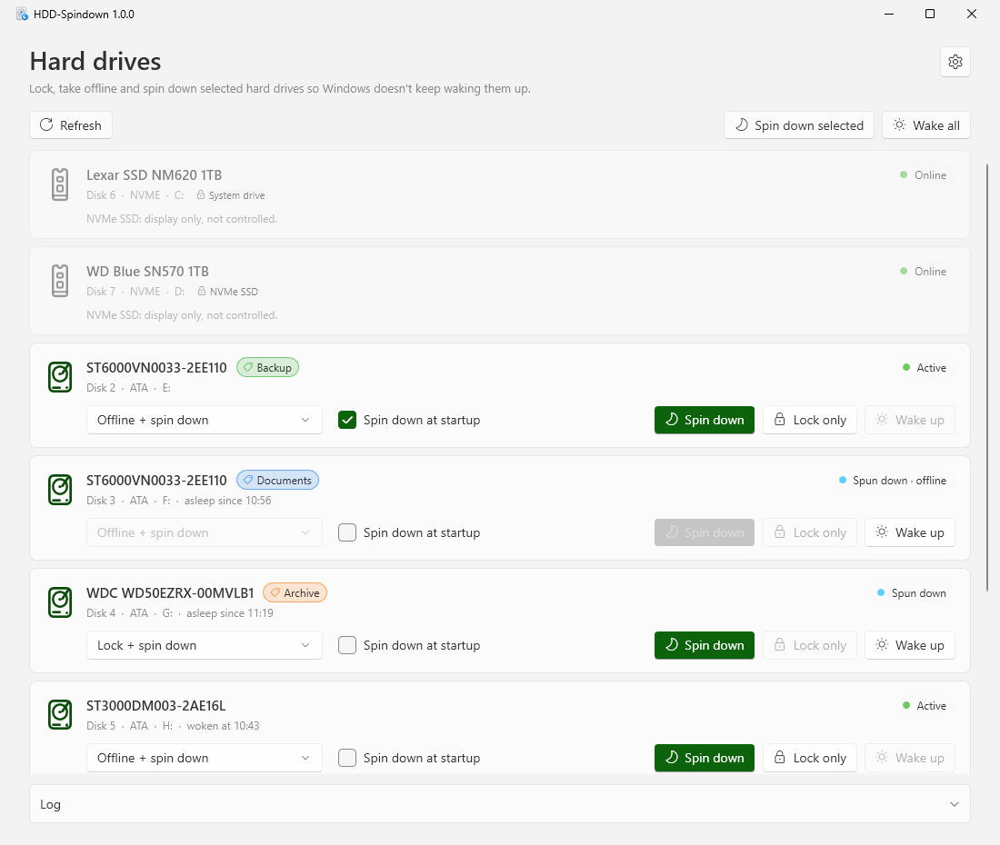
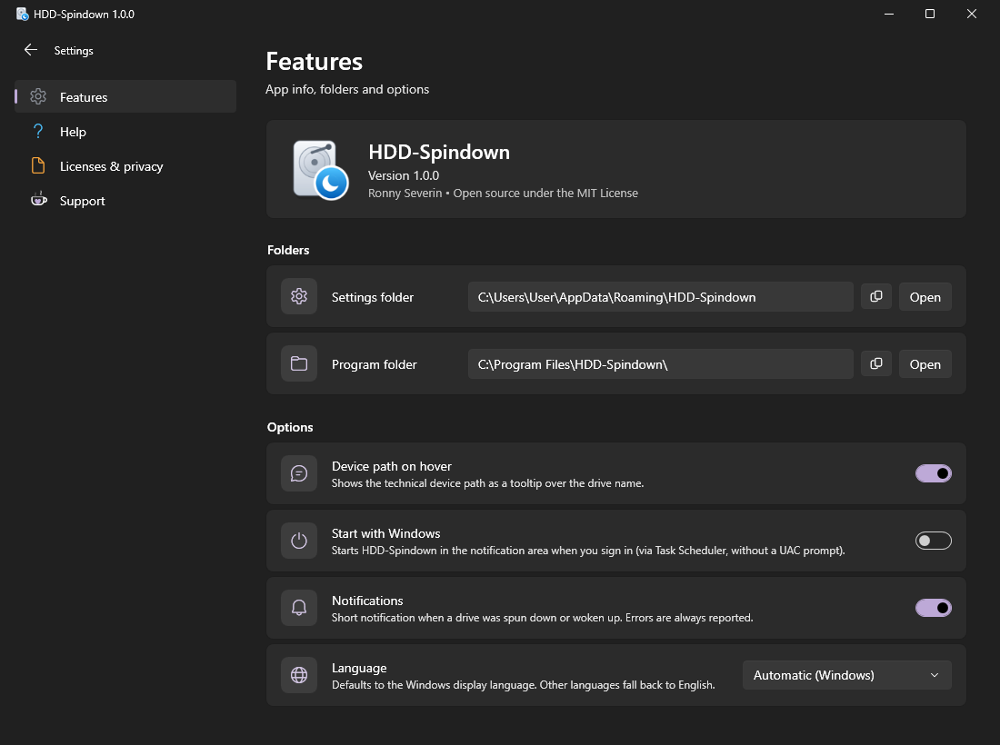
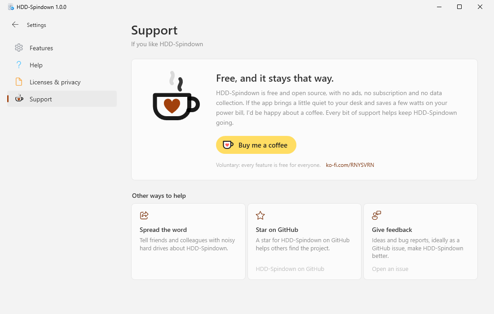

<p align="center">
  
</p>

<h1 align="center">HDD-Spindown</h1>

<p align="center">
  Spin down hard drives on Windows 11, and keep them asleep.<br>
  <b>English</b> · <a href="README.de.md">Deutsch</a>
</p>

<p align="center">
  <a href="https://github.com/RNYSVRN/HDD-Spindown/releases/latest"></a>
  
  <a href="LICENSE"></a>
</p>

<p align="center">
  
  
</p>

Windows likes to wake up hard drives even when nobody needs them. **HDD-Spindown** locks a drive's volumes or takes the drive offline first and only then sends it to standby, so it really stays quiet. Less noise, less power, less heat.

## Download

**[⬇ Download the latest installer](https://github.com/RNYSVRN/HDD-Spindown/releases/latest)** (`HDD-Spindown-Setup-x.y.z.exe`)

No .NET installation needed, everything is included. Requires Windows 10 (1809) or Windows 11, 64-bit.

> [!NOTE]
> **Windows may warn you on first start.** HDD-Spindown is free and therefore **not code-signed** (a signature costs money every month).
> - *“Windows protected your PC”* (SmartScreen): click **More info** → **Run anyway**.
> - *“An Application Control policy has blocked this file”* (Smart App Control): Smart App Control only allows signed apps. HDD-Spindown then only runs with Smart App Control turned off (*Windows Security → App & browser control*). Note: once turned off, it can only be turned back on by resetting Windows. Decide for yourself.
> - The **UAC prompt** is expected: the app needs administrator rights to control drives.
>
> The complete source code is in this repository, so you can review it or build it yourself.

## Features

- **Three modes per drive**
  - *Lock + spin down*: volumes are locked and dismounted, then the drive spins down
  - *Offline + spin down*: additionally takes the drive offline (most reliable, back online after a restart)
  - *Offline + spin down + disable*: additionally disables the device in Device Manager
- **Live status**: active, asleep, locked, offline; “asleep since …” / “woken at …”, even if Windows spun the drive down by itself
- **Shows what blocks a drive**: if a drive is in use, a dialog lists the programs holding it, with *Try again*
- **Spin down at startup**, **Start with Windows** (via Task Scheduler, no UAC prompt) and a **tray icon** with a native, dark/light-aware menu
- **Labels** with colors (e.g. “Movies”, “Backup”)
- **Protected drives**: NVMe SSDs and the system drive are display-only and never touched
- **Windows 11 Fluent design**: light/dark mode, your accent color, responsive layout
- **English and German**, following the Windows display language
- **Command line** for scripts and shortcuts
- **Private**: no internet connection, no telemetry, no account

<p align="center">
  
  
</p>

## Command line

```
HddSpindown -s J:                 spin down drive J: (optional: -m OFFLINE | DEACTIVATE | SLEEP)
HddSpindown -l J: -m OFFLINE      lock only
HddSpindown -w J:                 wake up (without a drive: all)
HddSpindown -t                    start in the notification area only
HddSpindown --lang en|de          force a language
```

The pattern matches a drive letter (`J:`), the drive name, device path or instance ID. If the app is already running, the command is passed on to it.

## Good to know

- If a drive can't be locked, nothing is forced (no data loss). Close the listed programs and click *Try again*.
- `beforeSleep.bat` / `afterSleep.bat` in the program folder run before spinning down / after waking (arguments: drive letter, name, device path).
- Settings are stored in `%AppData%\HDD-Spindown\settings.json`. Uninstalling keeps them; delete the folder to remove everything.
- Frequent spin-ups stress the mechanics, so don't spin drives down every few minutes.

## Build from source

Requirements: [.NET 10 SDK](https://dotnet.microsoft.com/download), optionally [Inno Setup 6](https://jrsoftware.org/isdl.php) for the installer.

```powershell
dotnet build src/HddSpindown -c Release              # app
powershell -ExecutionPolicy Bypass -File installer\build.ps1   # self-contained build + installer in dist\
```

## Support

HDD-Spindown is free and stays that way. If it saves you some noise and a few watts, I'm happy about a coffee:

<a href="https://ko-fi.com/RNYSVRN"></a>

Ideas and bug reports are welcome as [issues](https://github.com/RNYSVRN/HDD-Spindown/issues).

## Credits

The idea comes from [revoSleep](https://www.meinfach.net/revosleep/), a freeware tool that has sent hard drives to sleep for years. HDD-Spindown is an independent rewrite from scratch: it contains no code from revoSleep. For familiarity it follows the same conventions for the command line switches and the `beforeSleep.bat` / `afterSleep.bat` hooks.

## License

[MIT](LICENSE) © 2026 Ronny Severin.
